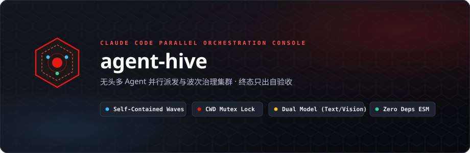
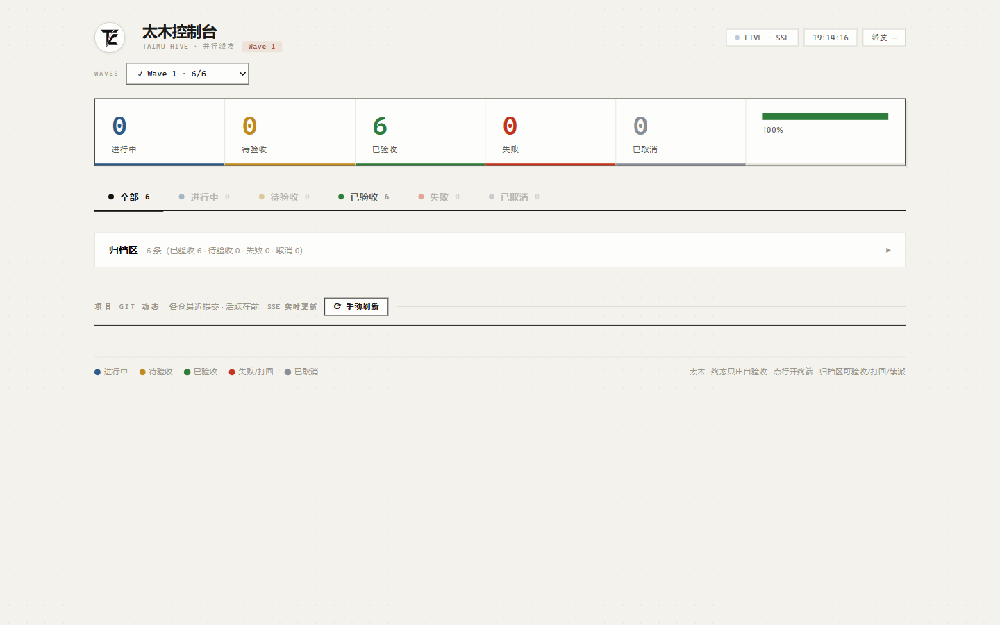
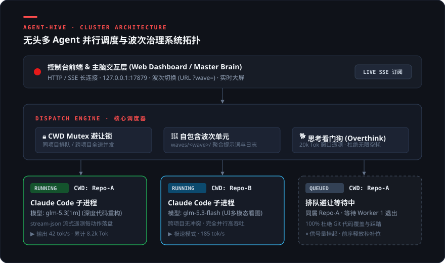

<div align="center">



<br/>

[](LICENSE)
[](#快速上手)
[](#核心架构)
[](https://docs.anthropic.com/en/docs/agents-and-tools/claude-code)
[](#设计美学)

<br/>

**把任务包分发给多个 Claude Code 无头会话 · 双模型路由 · 实时终端观测 · 终态只出自验收**  
*Parallel Headless Session Dispatcher & Wave Governance Console for Claude Code*

</div>

---

## 🖥️ 控制台界面实景

基于原生 Web 标准与 **Swiss Industrial Print（瑞士工业印刷美学）** 打造的高密度掌控台，支持 SSE 增量遥测、任务大屏、波次归档与实时抽屉终端：

<div align="center">
  
</div>

---

## 🏛️ 核心架构拓扑

<div align="center">
  
</div>

---

## ⚡ 核心特性矩阵

| 特性模块 | 说明与工程壁垒 |
| :--- | :--- |
| **🌊 自包含波次单元 (Self-Contained Wave)** | 任务配置、提示词、验收报告与运行日志全部收敛在单个 `waves/<wave>/` 目录内，零跨波污染，归档即插即拔。 |
| **🔒 目录互斥避让锁 (CWD Mutex)** | 调度引擎自动识别任务所在本地目录。**同一代码仓库绝对不并发**，彻底消灭 Git 冲突；跨仓库任务无缝并行，榨干模型吞吐。 |
| **🔄 终态只出自验收 (Verification First)** | 进程退出 ≠ 任务成功！遵循 `pending → running → reported → accepted / rejected` 严格状态机，无报告或异常直接标红。 |
| **⚡ 会话原地续派 (`--resume`)** | 报告打回或需要补充任务时，直接派回原有子进程上下文（免去冷启动重新扫描仓库的 Token 浪费）。 |
| **🖥️ 实时流式终端 (Stream-JSON Drawer)** | 零延迟解析 Claude Code 输出事件，工具调用、思考过程分色渲染，支持实时字节偏移断点续传。 |
| **🐕 思考看门狗 (Thinking Watchdog)** | 自动监测大模型异常死循环与思维溢出（Overthinking），面板醒目标记，防止无限空耗 Token。 |
| **🤖 主脑自治巡检协议 (Supervision Protocol)** | 提供 `app/supervise.mjs` 巡检脚本，主 Agent 可一键获取全集群健康报表，日常小问题自治修复，重大卡点主动升级。 |

---

## 🚀 30 秒极速上手

### 1. 启动控制台

`agent-hive` 采用纯原生 Node.js ESM 编写，**无需 `npm install` 任何三方包**：

```powershell
# 启动控制台（默认端口 17879 → http://127.0.0.1:17879）
node app/server.mjs

# 自定义端口运行
$env:PORT=17878; node app/server.mjs
```

### 2. 配置环境凭据

控制台会自动按序探测大模型 API 凭据：
1. 环境变量 `ZHIPU_API_KEY` 或 `ANTHROPIC_AUTH_TOKEN`
2. 本地凭据文件 `~/.claude/zhipu.env`

```powershell
$env:ZHIPU_API_KEY = "your-api-key"
```

### 3. 定义并派发首个波次任务

在 `waves/wave1/batch.json` 中声明任务包：

```json
{
  "wave": "wave1",
  "title": "项目重构与修复波次",
  "tasks": [
    {
      "code": "TASK-1",
      "name": "修复核心模块类型错误",
      "goal": "执行 pnpm typecheck 并解决所有 TypeScript 报错",
      "model": "glm-5.3[1m]",
      "cwd": "../your-project",
      "promptFile": "prompts/TASK-1.md"
    }
  ]
}
```

在浏览器打开 `http://127.0.0.1:17879`，即可实时观看会话推演、查看流式终端、验收成果或一键续派！

---

## 🎨 设计哲学：Swiss Industrial Print

`agent-hive` 坚决摒弃脆弱易错的字符画与漂移的 Emoji，严格恪守 **瑞士工业印刷风格（Swiss Industrial Print）**：
* **色彩哲学**：纸感浅色底板 `#F4F4F0` + 油墨黑文字 `#111` + 珊瑚红 `#E61919` 点睛品牌。
* **语义指示**：进行中（墨蓝 `#2D5A88`）、已验收（印刷绿 `#3A7D44`）、排队中（琥珀金 `#B07D1A`）、异常（印章红）。
* **版面纪律**：网格排版，发丝线分界，等宽字体仅用于哈希、路径、Token 遥测与时间戳。

---

## 📡 核心 API 一览

| 路由 | 方法 | 功能描述 |
| :--- | :---: | :--- |
| `/api/waves` | `GET` | 获取工作区内所有可用波次及其汇总进度 |
| `/api/batch?wave=<w>` | `GET` | 获取指定波次中所有任务的状态、SessionID、耗时与成本 |
| `/api/dispatch` | `POST` | 派发任务 `{ wave, code, resume, prompt }`，自动处理 CWD 排队 |
| `/api/accept` | `POST` | 审核验收任务 `{ wave, code, verdict: "accept" \| "reject", reason }` |
| `/api/logs/<code>` | `GET` | 增量拉取任务的 `stream-json` 终端执行日志 |
| `/api/kill` | `POST` | 强制终止挂死或超时的 Agent 子进程 |

---

## 📄 License

[MIT License](LICENSE) © 2026 Huanrui Zhang (TimeCraker)
